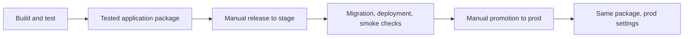

# GitHub Actions and Azure application hosting

Backend session releases also require the additive session migration, persistent Data Protection keys and a Supabase Magic Link template update. See [backend session rollout](backend-sessions.md#rollout-and-verification). Bicep manages Auth__Session__KeyRingPath and persistent App Service storage; these need no new GitHub secrets. Apply the infrastructure settings before deploying this version.


Current source refactors visibility sharing into independent organisation/team copies. Review the [data migration and membership changes](independent-copies.md) before a separately authorised release; existing hosted environments are not migrated by preparing this change.

Azure hosts the combined .NET 10 API and React frontend. **Supabase PostgreSQL replaces Azure SQL.** Email OTP Auth works locally, and the owner reports that the limited staging application is deployed and working. Organisation/team permissions are implemented; application invitations and production recovery preparation remain future work. The owner reported removing the old SQL/network/vault resources. Current IaC restores Key Vault for runtime secret storage; it does not restore Azure SQL or SQL networking.

## Existing Azure connection: keep it

Keep one GitHub environment named **stage**, one Azure resource group **rg-hockey-stage**, one B1 hosting plan **asp-hockey-stage**, web app **hockey-mgmt-app-stage**, and deployment identity **id-hockey-stage-deploy**. The separate `prod` environment uses the same workflow templates with its own settings and identity.

The same identity deploys infrastructure and the application using short-lived GitHub OIDC tokens. Keep its Contributor assignment scoped to `rg-hockey-stage`. **No Azure client secret or publish profile is needed.** The client ID identifies the managed identity; federation and its Azure role assignment authenticate and authorize the workflow. This Azure connection is independent of Supabase database credentials. [Azure OIDC guidance](https://learn.microsoft.com/en-us/azure/developer/github/connect-from-azure-openid-connect)

If recreating the identity, use Azure Portal → **Managed Identities**, then add a federated credential with these verified repository details:

| Field | Value |
| --- | --- |
| Organization/owner | `alillje` |
| Organization ID | `89385844` |
| Repository | `hockey-mgmt-app` |
| Repository ID | `1429378830` |
| Entity type / environment | Environment / `stage` |
| Credential name | `github-stage-deploy` |
| Issuer | `https://token.actions.githubusercontent.com` |
| Audience | `api://AzureADTokenExchange` |
| Subject | `repo:alillje@89385844/hockey-mgmt-app@1429378830:environment:stage` |

This repository uses GitHub's immutable OIDC subject format. Do not replace it with the older name-only subject. The numeric Organization ID is the personal owner's public numeric ID. Copy the identity's **Client ID**, not Principal/Object ID, into `AZURE_CLIENT_ID`. [GitHub immutable subjects](https://docs.github.com/en/actions/reference/security/oidc#immutable-subject-claims)

App Service's system-assigned identity resolves the database Key Vault reference. The existing deployment identity submits a secure parameter to Azure Resource Manager when applying Bicep; Bicep creates or updates the vault secret. Migrations use the GitHub secret directly. The vault's access policy grants the app **Get** on secrets. The deployment identity uses its existing resource-group Contributor assignment for the ARM deployment; it does not need a Key Vault data-plane Set/Get policy or a new RBAC assignment. [Key Vault reference permissions](https://learn.microsoft.com/en-us/azure/app-service/app-service-key-vault-references), [secure Bicep parameters](https://learn.microsoft.com/en-us/azure/azure-resource-manager/bicep/scenarios-secrets)

Keep Microsoft.Web, Microsoft.KeyVault, and Microsoft.ManagedIdentity provider registration. No SQL administrator group, VNet integration, SQL service endpoint, private endpoint, or Azure SQL server is provisioned. Network restrictions are deferred. The vault's public HTTPS endpoint still requires Entra authentication and the configured policies; no anonymous secret access is enabled.

## GitHub variables and secrets

Use **Settings → Secrets and variables → Actions → Variables** for repository variables. Use **Settings → Environments → stage** for environment variables and secrets. Keep the existing `stage` environment restricted to main, with review controls where supported by your GitHub plan. Do not create a second staging environment.

| Name | Storage | Purpose |
| --- | --- | --- |
| `AZURE_SUBSCRIPTION_ID` | Repository variable | Existing hosting subscription |
| `AZURE_TENANT_ID` | Repository variable | Existing Entra tenant |
| `AZURE_RESOURCE_GROUP` | Existing repository or stage variable | `rg-hockey-stage`; environment value wins if both exist |
| `AZURE_WEBAPP_NAME` | Existing repository or stage variable | `hockey-mgmt-app-stage` |
| `AZURE_CLIENT_ID` | stage variable | Client ID of `id-hockey-stage-deploy` |
| `LEGACY_WORKSPACE_ADMIN_USER_ID` | stage variable | Your existing Auth user UUID for platform administration and legacy-data adoption; required to create organisations or appoint their administrators |
| `SUPABASE_PROJECT_REF` | stage **variable** | Staging project reference used to validate the connection target |
| `SUPABASE_URL` | stage **variable** | Public project URL for the staging sign-in screen and API token validation |
| `SUPABASE_PUBLISHABLE_KEY` | stage **variable** | Browser-visible publishable key for staging sign-in |
| `SUPABASE_DATABASE_CONNECTION_STRING` | stage **secret** | Standard Supabase project connection used by runtime and migrations |

The infrastructure workflow checks that `SUPABASE_URL` matches `SUPABASE_PROJECT_REF`. The database connection belongs in **Secrets** only; the duplicate GitHub Variable was removed by the owner.

Remove **AZURE_SQL_ADMIN_OBJECT_ID** and **AZURE_SQL_ADMIN_NAME**. Remove unused **AZURE_PROD_SQL_ADMIN_OBJECT_ID** and **AZURE_PROD_SQL_ADMIN_NAME** if previously created. The production preparation workflow reads `AZURE_WEBAPP_NAME` from the separate GitHub `prod` environment, so a legacy `AZURE_PROD_WEBAPP_NAME` is not needed.

See [Supabase database setup](supabase-database.md) for the required Npgsql connection format, schemas, and manual Azure resource retirement. The Auth URL, publishable key, and user IDs are public configuration; no service-role key, Supabase API token, Google credential, or Azure client secret is required. Do not paste passwords in chat. The connection enters a **secure** Bicep parameter during a manual infrastructure run; it must not enter committed files, uploaded artifacts, workflow inputs, logs, or React/Vite variables.

Bicep retains separate `iac/parameters/stage.bicepparam` and `iac/parameters/prod.bicepparam`. Hosting region and B1 tier remain explicit reviewed parameters. B1 incurs charges while the app is stopped; it is retained here rather than silently changing compute capacity. Supabase database charges are separate.

## Workflow tasks

There are three runnable workflows. A push validates and packages the application; every hosted deployment remains manual.

| Workflow shown in Actions | Trigger | Purpose |
| --- | --- | --- |
| **Build and test** (`ci.yml`) | PR, push to `main`, or manual validation | Format checks, SQLite/PostgreSQL API tests, frontend/browser checks, publish, apply the Linux EF bundle twice to disposable PostgreSQL, lint workflows and Bicep. Only successful push builds on `main` can supply release packages. |
| **Release application** (`release.yml`) | Manual, from `main`; choose `stage` or `prod` | Stage deploys the successful CI package for the dispatch commit. Prod promotes the exact package from the latest successful stage release. |
| **Deploy infrastructure** (`infrastructure.yml`) | Manual, from `main`; choose environment and `preview` or `apply` | Compile the selected `.bicepparam`, validate target/TLS settings, preview resources, optionally apply Bicep, and remove private runner parameters. |

`deploy-application.yml` is the shared deployment template, called by Release application. It has no manual trigger. The template binds its job to the existing GitHub environment, so that environment supplies variables, secrets, and Azure OIDC identity. No environment or credential renaming is required. GitHub environment approvals can be added where supported by the repository's visibility and plan.



### Normal stage release

1. Push reviewed changes to `main` and wait for **Build and test** to succeed.
2. For schema changes, open that CI run's **application** artifact and review `postgresql.sql` before releasing. It is the same SQL packaged beside the tested application and Linux EF bundle. Downloading it needs no Azure or database credentials.
3. Open **Release application → Run workflow**, select branch `main` and environment `stage`.
4. The selection job links the chosen CI build and fixes its commit, run attempt, artifact ID, and SHA-256 digest for this release. Review the summary and deployment results.
5. The deployment checks current and packaged readiness, enters maintenance, applies pending migrations, deploys/starts the matching package, refreshes Key Vault references, and verifies health, database readiness, public Auth configuration, anonymous API rejection, and React.
6. Check actual email sign-in, save/reload, and logout in the browser. Smoke checks cannot follow an email link on your behalf.

There is no separate database initialization task. The same EF bundle creates the application schemas/tables on a fresh database and applies only pending migrations on an existing database. With no pending migrations, it makes no schema changes. New application databases start without example content.

### Promote to prod

Open **Release application → Run workflow**, select `main` and environment `prod`. Production selects the application recorded by the most recent successful stage release, even if `main` has moved since that stage release. The current workflow/checks orchestrate deployment; the application and migrations remain pinned to the stage-tested artifact. The selection summary links both its original CI build and stage release.

A stage record is created only after deployment and smoke checks pass. Promotion checks the originating workflow/repository/branch, successful run and attempt, package ID and digest, and availability. Failed/cancelled stage runs cannot authorise promotion. Re-running only failed CI jobs may leave an older package attempt; rerun all CI jobs or push a new commit, then release to stage again. It never rebuilds or substitutes a newer CI package. Expired artifacts or a CI rerun require another stage release; do not bypass the check by manually deploying from a developer machine.

**First use after this workflow refactor:** push the changes, let the new CI package succeed, and release to stage once. Older workflows did not create the promotion record; they cannot authorise the first prod promotion. Artifacts and release records are retained for 14 days. Record/package expiry blocks promotion with an explanation.

### Infrastructure changes

Run **Deploy infrastructure** only when Bicep, hosting settings, or an environment's database secret changes. Select the destination environment and `preview`, review the proposed changes, then run `apply`. Each apply also previews before making changes. Separate `stage.bicepparam` and `prod.bicepparam` files remain authoritative. Infrastructure does not deploy application binaries or run database migrations.

Release and infrastructure workflows share one concurrency group per environment. They cannot mutate the same environment simultaneously; stage and prod retain separate resources and locks. Environment secrets remain scoped to deployment jobs. Readiness checks, separate production-target checks, pinned action SHAs, and maintenance failure handling are preserved. A release failure after entering maintenance leaves the app stopped; no automatic Down migration, restore, or old-code restart runs.

The CI workflow also validates workflow syntax/expressions with a checksum-pinned actionlint binary and tests release selection, promotion provenance, artifact metadata, and packaging without hosted credentials. If branch protection requires a previous check name, update it to the current **Validate infrastructure and release workflows** check alongside the existing application check.

Private infrastructure parameters are compiled under the runner's temporary directory with restricted permissions and removed on completion or failure. Resource-ID-only what-if output avoids printing the secure connection parameter. Bicep writes the database secret to Key Vault on apply; application releases use the GitHub environment secret for migrations and refresh the app's existing vault reference.

## Environment-specific settings in Bicep

The stage parameter file defines `keyVaultName = 'kv-hockey-stage'` and `databaseSecretName = 'supabase-db-connection'`. The separate production-project evaluation uses `kv-hockey-prod` through the same workflows with `environment=prod`. Names have no random suffix. Key Vault names must be globally available; choose another simple readable name in the appropriate parameter file if Azure reports a conflict. A soft-deleted vault can reserve its name; recover it intentionally rather than purging it automatically.

`iac/modules/application-settings.bicep` owns `Database__Provider`, `AllowedHosts`, `ASPNETCORE_ENVIRONMENT` (Staging/Production), `ConnectionStrings__Hockey`, `Auth__Mode`, `Auth__SupabaseUrl`, and `Auth__SupabasePublishableKey`. The stage infrastructure workflow reads the public Auth values from GitHub `stage` variables and compiles them into the Bicep parameters. The connection setting is a versionless `@Microsoft.KeyVault(SecretUri=https://<environment-vault>.vault.azure.net/secrets/supabase-db-connection)` reference. Bicep stores the supplied Npgsql connection unchanged in the vault secret. The workflow no longer calls `az webapp config appsettings set`. Unrelated settings remain preserved using the secure parent-to-module merge, avoiding the earlier circular dependency.

The vault is Standard, with soft delete, 90-day retention, and purge protection. It uses a public endpoint without VNet/firewall restrictions in this phase. Bicep owns its secret and access policy. App release explicitly refreshes references before smoke checks, avoiding the normal reference-cache delay after an infrastructure rotation. [Key Vault reference caching](https://learn.microsoft.com/en-us/azure/app-service/app-service-key-vault-references)

## Apply the infrastructure cleanup

After reviewing and pushing this change, run **Deploy infrastructure → main → stage → preview**, review the vault name, app Get policy, and app settings, then explicitly choose **apply**. The apply creates or updates the vault and its database secret through Bicep, then configures the app reference. Keep the app stopped until a reviewed release; an older deployed app might not use the new PostgreSQL settings correctly. If apply fails, inspect the deployment operations and rerun preview before retrying.

Keep `SUPABASE_PROJECT_REF` in the stage environment's Variables and `SUPABASE_DATABASE_CONNECTION_STRING` in its Secrets. Set the connection secret to the documented **Npgsql** format before preview/apply; an existing Supabase dashboard URI must be replaced. The deployment identity retains its existing Azure role, and the app's system-assigned Principal ID is resolved by Bicep. No additional identity-ID variable is needed.

Infrastructure apply does not deploy the application, create Supabase resources, or migrate its database. Incremental Bicep does not delete old resources. Keep the new `kv-hockey-stage` vault and existing deployment identity, resource group, app, and hosting plan. If the GitHub database secret changes, run infrastructure **apply** to update the vault before a new app release; otherwise migrations could use a different connection from the running app. No live provisioning was performed by this code change.

## Before application deployment

The selected environment must have the Azure/GitHub variables and secret above, its public database CA, and reviewed Bicep/readiness settings. For a fresh environment, preview/apply infrastructure first, review the CI package's migration SQL, then use the normal release workflow. Hosting access is configured explicitly in the selected `.bicepparam` file; a release does not open a private site.

`iac/stage/application-readiness.json` and `iac/prod/application-readiness.json` track prerequisites. [Staging readiness evidence](staging-readiness.md) records verification and remaining work. The temporary evaluation recovery deferrals must be revisited before production reliance. API membership checks restrict content access; the platform administrator uses the explicit configured Auth user UUID. The OTP email request does not create new users (`create_user: false`).

Use [the workflow sequence above](#workflow-tasks) for normal releases and [production preparation](production-preparation.md) for the separate project's settings. No local Azure deployment or direct database-update command is part of release operations.

## Local verification

```bash
source scripts/toolchain.sh
python3 -m unittest discover --start-directory scripts/azure/tests
# With actionlint 1.7.12 installed:
actionlint -shellcheck=
az bicep build --file iac/main.bicep
az bicep lint --file iac/main.bicep
```

The project-local pinned compiler may also be used without Azure login. Compile both parameter files with validation-only web-app names, as CI does. Compilation does not prove a live Azure deployment, Supabase connectivity, auth, or recovery. See [database modes and publishing](database-and-publishing.md) for application checks.
