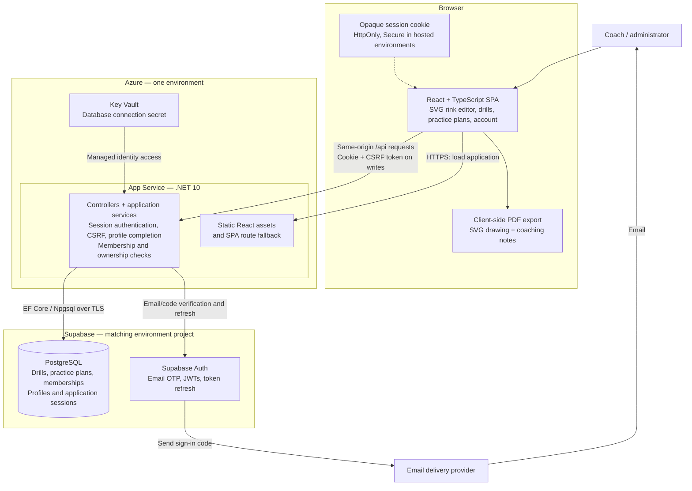
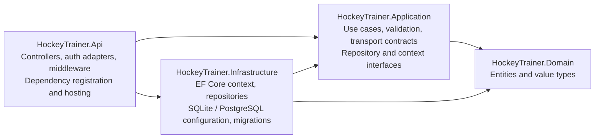
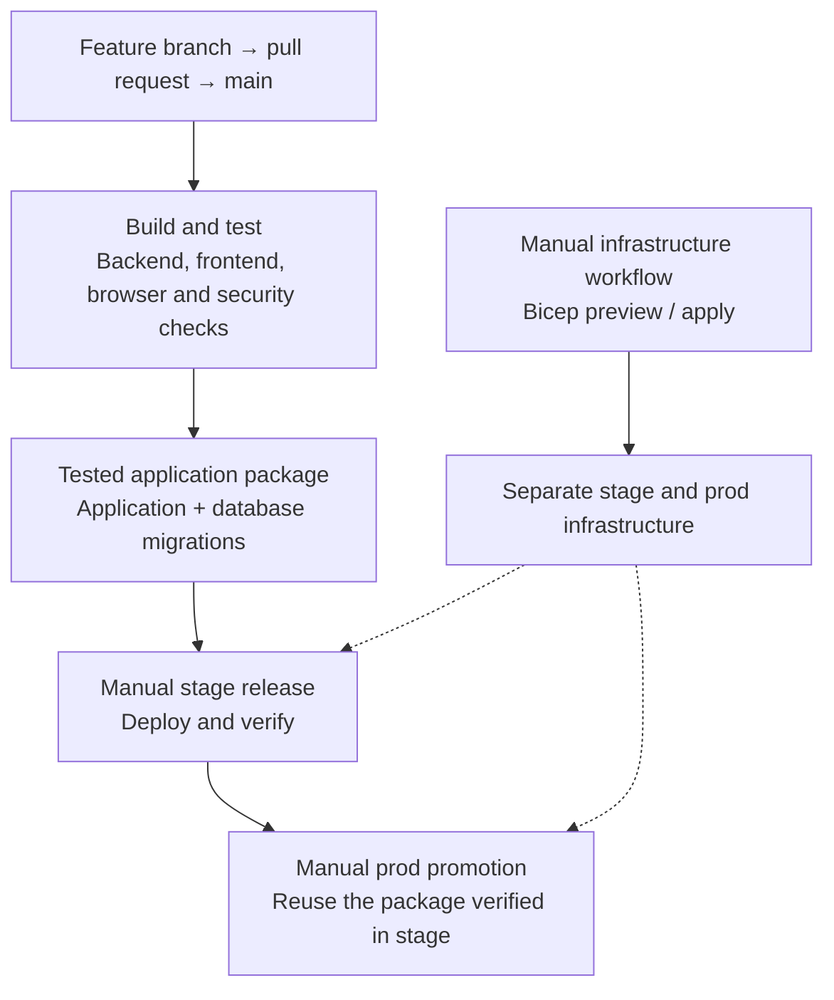
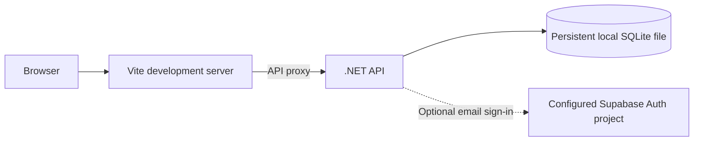

# IceWork system architecture

This public overview describes the main components and boundaries in the current repository. It is not an audit of live service configuration. The diagrams use Mermaid and render directly on GitHub.

## Running system

Azure App Service serves the compiled React frontend and the .NET 10 API from one application and origin. The API communicates with Supabase Auth and PostgreSQL. Stage and prod each have their own Azure resources, Supabase project and GitHub environment configuration.

- The browser uses an opaque session cookie. Supabase tokens are handled on the server.
- The backend authenticates requests and enforces organisation membership, team roles and content ownership.
- The application accesses PostgreSQL through .NET. Browser requests go to the application's API.
- The combined application enforces CSRF protection, CSP, browser security headers and API rate limits.
- Rink drawings are versioned diagram data stored with drills. PDF export happens in the browser.

## Backend boundaries

Solid arrows below represent project references, not network requests. Controllers call application use cases; infrastructure implements the interfaces those use cases need. The API composes the implementations at startup.

The React frontend uses a shared API client boundary and feature components. Editor geometry and history are independent of rendering. Shared SVG components render the editor, saved previews and the drawings used in PDFs.

Content belongs either to a team workspace or the organisation library. Practice plans reference drills in the same workspace, with ordered entries containing duration and practice-specific notes. Copying a complete plan creates a new plan and new drills in the destination, within a transaction. Copies have independent ownership and no update propagation. See [independent copies](independent-copies.md).

## Build, infrastructure and release

Infrastructure and application releases are separate manual workflows. CI builds and tests the combined application and produces a deployable package with database migrations. CI uses an isolated database for testing.

Stage and prod use separate environment configuration and Supabase projects. Infrastructure is defined in Bicep, and deployment authentication uses GitHub Actions OIDC. Database migrations are reviewed and applied through the release workflow. Some external service settings are managed separately from infrastructure code.

## Local development

Local development runs Vite and .NET with persistent SQLite storage. Supabase sign-in can be enabled for local authentication testing. Browser security checks also run against the published combined application.

## Sources in this repository

- [Solution and backend project boundaries](../HockeyTrainer.slnx)
- [API composition, middleware and hosting](../backend/HockeyTrainer.Api/Program.cs)
- [Frontend publishing into the API](../backend/HockeyTrainer.Api/HockeyTrainer.Api.csproj)
- [Infrastructure composition](../iac/main.bicep) and [environment app settings](../iac/modules/application-settings.bicep)
- [CI](../.github/workflows/ci.yml), [infrastructure workflow](../.github/workflows/infrastructure.yml), [release selection](../.github/workflows/release.yml) and [deployment template](../.github/workflows/deploy-application.yml)
- [Publishing and migration packaging](../scripts/publish.sh)
