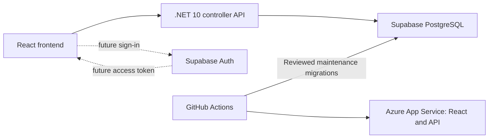

# Teams, Supabase Auth, and hosting plan

Updated direction, 2026-10-22: retain React/TypeScript and the .NET 10 controller API; use **Supabase PostgreSQL**, then **Supabase Auth** when explicitly requested. Azure hosts the combined frontend/API. This replaces the earlier Azure SQL, ASP.NET Identity/provider-cookie, Key Vault, and VNet proposals. It does not authorize auth/team implementation or public hosting now.

Database preparation is the current implementation scope. [Supabase setup](supabase-database.md), [database modes](database-and-publishing.md), and [Azure/GitHub deployment](azure-deployment.md) describe the executable path and outstanding verification. Existing local SQLite data remains local until an explicit import is designed.

## Deployment topology

Start with staging only: one Supabase project and one existing Azure web app/hosting plan in `rg-hockey-stage`. Keep one GitHub `stage` environment and the existing Azure OIDC deployment identity. Supabase database credentials are independent from Azure OIDC. Production will receive a separate Supabase project, app configuration, credentials, and release controls after a later approval; no production workflow is connected now.

The C# API owns application data access and business rules. Application tables use `hockey`; migration history uses `hockey_migrations`. Keep both schemas out of the exposed Supabase Data API. Use the standard project postgres connection for both runtime and migrations in the staging POC; revisit separate restricted credentials before production. Reviewed EF migrations run during a stopped-app maintenance window, never on API startup. CI verifies disposable PostgreSQL behavior and the Linux EF bundle.

Azure SQL, SQL-specific networking, and unused Key Vault are retired from templates. The owner deletes obsolete Azure resources manually after preserving needed data and detaching VNet integration. Keep B1 hosting unchanged for this transition; any tier reduction is a separate reviewed cost choice.

## Future authentication — deferred

Use Supabase Auth for Google sign-in initially; confirm any additional providers when that phase starts. React uses Supabase's supported authentication flow. The C# API verifies access tokens using trusted asymmetric signing keys and validates issuer, audience, expiry, and signature. Supabase provides a [JWKS endpoint](https://supabase.com/docs/guides/auth/signing-keys) and [Google provider support](https://supabase.com/docs/guides/auth/social-login/auth-google).

Choose the browser session/token-storage strategy deliberately during auth design. Do not carry forward the previous ASP.NET Identity and Azure Key Vault/Data Protection key-ring design automatically. If a backend cookie session is chosen, design anti-forgery and durable session handling for that specific flow. Resolve refresh, logout/revocation, key rotation, verified email, and staging tester access before enabling hosted sign-in.

Use Supabase's stable user subject as identity; email is contact information. Review account linking and verified-email behavior rather than assuming email establishes ownership. Never give the frontend database passwords or secret/service-role keys. No auth keys or provider credentials are needed for today's database-only change.

Database connections from C# use a runtime service role, so Supabase does not automatically restrict queries to the current browser user. Team membership and roles must be checked by the API for every request. Do not assume adding Supabase Auth also implements team isolation.

## Teams and content ownership

A signed-in user creates a team or accepts an invitation. A creator becomes Owner; users in several teams choose the active team. Drills, practices, search, category folders, editor drafts, and PDF exports operate within the active team. New logins must not automatically gain access to existing POC content.

| Role | Read/export | Create/edit/delete content | Manage team/members/invitations |
| --- | --- | --- | --- |
| Owner | Yes | Yes | Yes |
| Coach | Yes | Yes | No |
| Viewer | Yes | No | No |

Allow multiple Owners, but prevent removal/demotion/departure of the last Owner. Team archival/deletion and recovery need an explicit design. Changes in membership/roles must affect the next authorized request rather than relying on stale token role claims.

Keep existing drill reference behavior: practices reference reusable drills, edits appear in their practices, and referenced drills cannot be deleted. Cross-team practice/drill references must be impossible. Historical drill snapshots remain deferred.

Proposed entities are an application profile linked to the Supabase user ID, Team, TeamMembership, TeamInvitation, team-owned Drill/Training/TrainingEntry, and focused audit events. Use uniqueness constraints and team-consistent foreign keys. Consider optimistic concurrency for shared editing. Controllers stay thin; services validate membership and business behavior; repositories enforce team-scoped access.

Every list, item read/write/delete/duplicate, nested drill creation, category count, and export must be authorized. Object IDs alone never establish ownership. Clear or partition frontend drafts/caches when the user or team changes. Already downloaded PDFs cannot be revoked.

## Invitations

An Owner selects Coach or Viewer and enters an email. Start with a copyable invitation link; automated email delivery can follow later. Use a random, single-use token stored as a hash, expiry, intended team/email/role, and inviter. Protect tokens from logs, referrers, and unnecessary browser persistence.

Acceptance requires sign-in, verified matching email, valid token/expiry, and a still-authorized inviter. Atomically consume the invitation and create membership. Handle duplicate acceptance/concurrent requests safely. Do not allow the request body to escalate the offered role. Owners can revoke/reissue links.

## Future API design

The implemented [API contract](api-contract.md) remains unchanged. Before auth/team implementation, agree auth/session endpoints and team-scoped contracts together. Likely surfaces include current-user/profile, teams, memberships, invitations and invitation acceptance, plus `/api/teams/{teamId}/drills` and `/api/teams/{teamId}/trainings`. Exact routes and response types remain a design decision.

Hosted anonymous content endpoints must not remain an authorization bypass. Local POC compatibility must be deliberate. Google credentials/redirect configuration belong in the later Supabase Auth setup, with separate environment configuration.

## Data, cost, and recovery

Preserve existing IDs, diagrams, notes, category assignments, practice order, and references if importing SQLite. Design a repeatable export/import against a backup; verify counts, diagrams, PDFs, and links. Assign imported content only to an explicitly chosen team. No automatic SQLite or Azure SQL import is part of this transition.

Supabase Free is suitable for evaluation but has inactivity pausing and capacity limits. Production availability and backup needs may justify Pro. Azure app hosting is a separate charge; Supabase is not automatically cheaper than the previous Azure SQL allowance. Confirm region, currency, quota, backup retention, and a monthly ceiling before paid provisioning. [Supabase pricing](https://supabase.com/pricing)

Back up before destructive changes, rehearse restore into a separate project/database, and record actual recovery times. Proposed recovery targets must be validated, not treated as guarantees. Application rollback requires schema compatibility; do not automatically reverse database migrations. Keep production data out of staging. Protect trusted release code, migration secrets, and deployment environment access.

## Phases and outstanding decisions

1. **Database now:** PostgreSQL provider/migrations, disposable CI integration tests, standard Supabase connection instructions, manual release wiring, and Azure SQL retirement. Configure the real staging project and verify migrations/runtime access/recovery before marking hosted readiness complete.
2. **Auth when requested:** confirm providers and session strategy; implement Supabase login/token verification, tester access, logout/revocation, and unauthorized-request tests.
3. **Teams:** implement ownership/membership/invitations and cross-team isolation throughout APIs, editor drafts, search, and exports.
4. **Staging review:** enable only the explicitly approved access scope, deploy a trusted artifact, test persistence, real login, isolation, billing, and recovery.
5. **Production later:** approve cost/capacity/environment controls, provision a separate project/app configuration, promote the tested artifact manually, and import only approved content.

Public staging flags remain false until the tracked prerequisites or a separately reviewed temporary test scope are approved. Nothing in this plan implements auth, teams, production deployment, or secret configuration.
