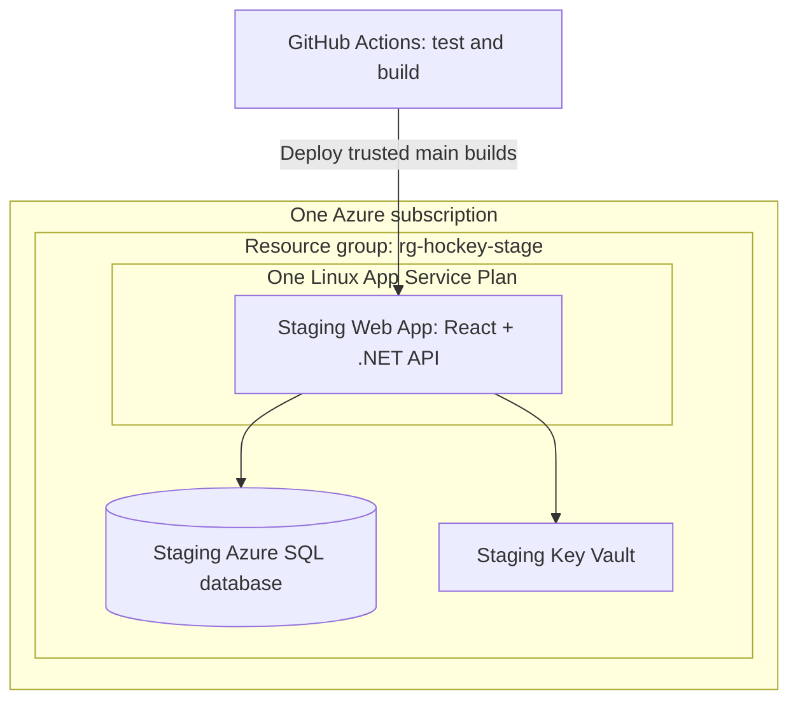

# Teams, authentication, and Azure hosting plan

Status: proposal for a later implementation. Written 2026-10-22. No application, infrastructure, workflow, or database changes are authorized by this document.

Preparation update: the user subsequently requested CI and IaC templates. These are now prepared locally, with a shared Bicep template, separate stage/prod `.bicepparam` files, and manual stage-only workflows sharing one GitHub `stage` environment with one staging deployment identity and `AZURE_CLIENT_ID`. See [Azure deployment setup](azure-deployment.md). The user has now configured the staging OIDC deployment connection and confirmed successful staging infrastructure deployment. Auth/teams remain unimplemented. SQL Server provider/migration and combined React/.NET publishing are prepared locally; real SQL Server integration has passed in CI. Azure runtime access, recovery, and application deployment remain pending. B1 + VNet + SQL service-endpoint networking and scripted database preparation are approved; see [the current setup guide](staging-database-automation.md). See [database implementation and verification limits](database-and-publishing.md).

## Recommended starting point

Keep React/TypeScript and the .NET 10 controller application. Add Google sign-in, team-owned content, and three team roles. Deploy the compiled frontend and API together in each environment.

Deploy only staging initially. Use one Azure subscription, one staging resource group, one Linux App Service web app, one hosting plan, one persistent Azure SQL database, and staging-only identity/secrets resources. Use the approved Linux B1 hosting tier for VNet integration and retain the SQL free offer for evaluation.

Do not provision production apps, databases, vaults, identities, provider registrations, or deployment workflows in the first rollout. Production is a separately approved future phase after staging has been evaluated. Preserve environment parameters in the design so it can be added without redesigning the application.

Stage-first deployment is the user's confirmed rollout constraint. The other defaults below are proposals, not decisions already approved for implementation. Microsoft account login, the database choice, region, and spending limit should be confirmed when work resumes.

## 1. User experience and team ownership

1. A visitor signs in with Google.
2. A new user can create a team or accept an invitation. They cannot see the existing local workspace automatically.
3. A team creator becomes an Owner. Owners can invite other coaches or viewers.
4. Users belonging to multiple teams select their active team. Home, Practices, Drills, search, category folders, and exports operate within that team.
5. The existing drill designer and practice workflows continue inside the selected team, including creating a drill while editing a practice.

Start with team-owned drills and practices. Personal libraries, cross-team sharing, subscriptions/billing, player attendance, and public drill publishing are separate future features. Accounts are initially for coaches and invited adult staff; no player personal data is needed.

| Role | Read drills/practices and export PDFs | Create/edit/delete content | Manage invitations/members/team |
| --- | --- | --- | --- |
| Owner | Yes | Yes | Yes |
| Coach | Yes | Yes | No |
| Viewer | Yes | No | No |

Allow multiple Owners. Prevent removing, demoting, or allowing the final Owner to leave. Owners can change roles and revoke access; role changes take effect on the next authorized request. Team deletion needs an explicit later design; initially offer archival and an Owner-assisted recovery process.

All team members share the team's library. Keep the existing rule that a referenced drill cannot be deleted. Practice drill references must belong to the same team. Editing a drill continues to update practices using it; historical snapshots remain deferred.

## 2. Authentication design

Use ASP.NET Core Identity for application users and external-login associations, with the Google authentication handler first. Microsoft account login can be added through a second provider after the first flow is proven. Identity supports external providers without requiring a local password feature. [Microsoft external login guidance](https://learn.microsoft.com/en-us/aspnet/core/security/authentication/social/?view=aspnetcore-10.0)

Serve React and `/api` from the same HTTPS origin in each environment. The backend completes the provider sign-in and issues a Secure, HttpOnly application session cookie. Keep provider tokens and application credentials out of browser storage. Do not retain provider access/refresh tokens for a sign-in-only application.

Planned controls:

- Provider state/correlation protection and provider middleware handle the external login flow; callback URLs are exact and environment-specific.
- Local user identity is linked to the provider's stable subject identifier. Email is contact information, not the account's primary identity.
- Do not automatically merge accounts from different providers based on email. Adding a second login requires an authenticated account-linking flow.
- Only trust an email as verified when the provider explicitly supplies trustworthy verification. An invitation needs a verified matching email; otherwise add a separate verification step before accepting it.
- Cookie lifetime and renewal are explicit: propose a 7-day absolute session cap with a shorter inactivity window. Prefer built-in Identity cookies and security-stamp validation; avoid a custom authentication/session framework. Add server-side session records only if the agreed per-device logout or revocation requirements need them.
- Require anti-forgery tokens for state-changing cookie-authenticated API requests, including logout; configure SameSite behavior compatible with provider redirects.
- Validate local return URLs and reject external redirects. Rate-limit login starts, invitation creation, and invitation acceptance.
- Use consistent JSON 401/403 responses for APIs. Only login endpoints redirect to the provider.
- Treat team membership and roles as live database authorization checks, not long-lived claims in the cookie.

Session encryption keys must survive deploys and restarts. Plan to persist ASP.NET Data Protection keys in each environment's SQL database, protect them with an environment-specific Azure Key Vault key, and use separate application names. Retain old wrapping-key versions while protected data still depends on them. This avoids another storage account solely for authentication keys. [Microsoft Data Protection configuration](https://learn.microsoft.com/en-us/aspnet/core/security/data-protection/configuration/overview?view=aspnetcore-10.0)

Separate development and staging provider registrations/credentials initially; create separate production credentials only in the future production phase. Staging uses an explicit tester allowlist in addition to normal team authorization. Never enable the unauthenticated POC mode in hosted environments.

## 3. Invitations

An Owner enters an email and chooses Coach or Viewer. Initially generate a link they can copy and send themselves; the application does not need an email service for this first release. Automated email delivery can be added later.

Invitations have a cryptographically random, single-use token, a seven-day expiry, an intended team, an intended normalized email, and the offered role. Store a hash of the token, not the raw token. Put the link token in the URL fragment so it is not sent in the initial page request; the frontend submits it in the acceptance request body after sign-in. Preserve it only as needed across the login redirect, then remove it from browser history/storage. Avoid recording tokens in application logs or analytics. Use a restrictive referrer policy on the acceptance page.

The recipient signs in before accepting. Acceptance verifies the token, expiry, revocation status, verified email match, and current inviting Owner's authority. It creates membership and consumes the invitation atomically. Reject role escalation from the request body. A repeated acceptance by an existing member must not create duplicate membership or silently change their role. Owners can revoke and reissue invitations.

## 4. Data model and authorization boundary

| Entity | Planned responsibility |
| --- | --- |
| ApplicationUser / external logins | Stable application account and linked provider subjects |
| UserSession (optional) | Add only if built-in Identity mechanisms cannot meet agreed session/revocation requirements |
| Team | Name, archival status, creator, timestamps |
| TeamMembership | Unique `(TeamId, UserId)`, role, joined timestamp |
| TeamInvitation | Team, email, role, token hash, inviter, expiry, consumption/revocation |
| Drill | Existing content plus required TeamId and creator/updater metadata |
| Training | Existing practice content plus required TeamId and creator/updater metadata |
| TrainingEntry | Existing order/duration/notes and team-consistent drill reference |
| AuditEvent | Team creation, role changes, invitations, and membership revocations |
| DataProtectionKey | Environment-specific persisted authentication key ring |

Use database constraints/indexes for membership uniqueness and team-safe relationships, plus service validation. Consider row-version concurrency checks for shared drill/practice edits so one coach cannot silently overwrite another coach's changes.

Classic controllers remain thin. Authentication, team authorization, invitations, and content use cases live in focused services; persistence stays in repositories/EF configuration. Do not build a separate identity microservice.

Every list/read/write/duplicate and nested practice operation validates access to the team. Object IDs supplied by clients never establish ownership. Cross-team resources should return a consistent not-found response; use forbidden for an authenticated member lacking a permitted action. Filter searches and category counts by team before returning results. Clear or partition frontend caches/drafts by signed-in user and team, including nested practice drafts. Do not reuse another user's tab/session data after login changes.

PDF export remains client-side and uses content already authorized for the team. No public file storage or permanent PDF URLs are required initially. Revocation prevents future access; already downloaded PDFs cannot be recalled.

## 5. Proposed future API surface

This is a design sketch; the current `docs/api-contract.md` remains the implemented contract. Finalize request/response types and errors before coding.

- `/api/auth/login/{provider}`, provider callbacks, `/api/auth/me`, anti-forgery bootstrap, and POST `/api/auth/logout`.
- `/api/teams` for listing a user's teams and creating a team.
- `/api/teams/{teamId}` for team details and Owner-managed settings.
- `/api/teams/{teamId}/members` and member-specific role/removal actions.
- `/api/teams/{teamId}/invitations` for creation/listing/revocation.
- POST `/api/invitations/accept` with the invitation token in the body.
- `/api/teams/{teamId}/drills` and `/api/teams/{teamId}/trainings`, with item endpoints beneath them.
- Keep the fixed category catalog global; category assignments and all content remain team-scoped.

Disable anonymous legacy content endpoints in the hosted release. Local POC compatibility must be deliberate and development-only; it cannot bypass team checks in staging/production.

## 6. Azure topology

The first deployment contains staging only:

Start with one staging resource group and clear cost tags. Resource groups organize lifecycle and permissions; limiting their count is not the main cost saving. Group staging data with staging resources. When production is approved later, prefer a separate production resource group and review whether the compute plan belongs in a shared group. A common database resource group is optional; it should not make it easier to delete both environments together. [Resource-group lifecycle guidance](https://learn.microsoft.com/en-us/azure/azure-resource-manager/management/manage-resource-groups-portal)

For stage-only evaluation, Linux B1 is now approved because VNet integration requires dedicated compute. It is charged even when the app is stopped. The SQL free offer remains capped, with pause-at-limit behavior. No NAT/VPN Gateway or private endpoint is part of this baseline.

Later, two separate web apps can share one paid App Service Plan. Dedicated-tier compute billing is at plan-instance level, and the apps share its CPU and memory. Move staging to a separate plan if it affects production. Creating only staging initially defers production database and supporting-resource costs; it does not halve compute cost compared with two apps on the same paid plan. Stopping a web app alone does not stop paid plan-instance billing. [App Service plans and billing](https://learn.microsoft.com/en-us/azure/app-service/overview-hosting-plans)

When production is added, use separate apps rather than deployment slots on a small paid tier. Slots require Standard, Premium, or Isolated; they can be reconsidered if seamless promotion becomes worth the higher tier. Basic deployments may briefly interrupt service. [Deployment slot requirements](https://learn.microsoft.com/en-us/azure/app-service/deploy-staging-slots)

Each app serves its own compiled React assets and API. Keep React routing fallback separate from API 404 responses. Use the built-in .NET 10 Linux runtime if available in the selected region at implementation time; verify its supported runtime identifier before provisioning. A self-contained publish is a fallback to evaluate, not a reason to add containers immediately.

Start with Azure-provided HTTPS hostnames. Add a purchased custom domain later. Prefer Sweden Central if all selected services/SKUs are available and reasonably priced; otherwise compare a nearby EU region such as North Europe. Put app and database resources in the same region and document backup location/residency choices.

Provision only staging managed identities, provider secrets, cookie names/key rings, database users, and configuration initially. Production must get its own equivalents when approved. Stage gets no production database or production vault permissions. Both staging deployment workflows share one deployment identity; the automatically created app runtime identity remains separate. Give runtime identities access to only their database and vault; use managed identity authentication to Azure SQL. [Managed identity connection guidance](https://learn.microsoft.com/en-us/azure/app-service/tutorial-connect-msi-sql-database)

Use App Service VNet integration, a Microsoft.Sql service endpoint, and a SQL subnet rule for the running app. No app outbound IP allowlist is maintained. SQL retains its public endpoint, permitting temporary caller-IP rules for scripted migration administration; those rules are removed afterward. Managed identity and database permissions remain required. Private endpoints and privately networked migration runners are deferred cost/design choices.

## 7. Persistent database choice

Recommend Azure SQL for the first hosted version, despite PostgreSQL being mentioned in the earlier backlog. Its small DTU tier and free-tier option are worth evaluating for this workload, and EF Core fits the current architecture. This is a proposed change of database direction, not a completed migration.

| Option | Proposed use | Main tradeoff |
| --- | --- | --- |
| Azure SQL Basic | Paid staging fallback; future production candidate | Paid, predictable capacity; 5 DTUs and a 2 GB database limit |
| Azure SQL free tier | Staging if the subscription/region supports it | Free allowance, no SLA, pause/cap behavior must be acceptable |
| Azure SQL free tier for both | Future option only after production is approved | Production can become unavailable at the monthly limit |
| Azure Database for PostgreSQL Flexible Server | Alternative if PostgreSQL is preferred | Obtain compute/storage/backup quote; compare full cost before deciding |
| SQLite on app storage | Keep for today's local POC | Do not make an app-local file the hosted multi-user persistence design |

Basic's 5-DTU/2-GB limit is small, so monitor database size and query performance, and plan a tier upgrade before capacity is exhausted. [Azure SQL DTU limits](https://learn.microsoft.com/en-us/azure/azure-sql/database/resource-limits-dtu-single-databases?view=azuresql)

The current SQL free offer includes 100,000 vCore-seconds and 32 GB of data per database monthly, with up to ten databases per subscription. It has no SLA. Selecting auto-pause at the free limit makes the database inaccessible until the next calendar month; continuing instead can incur serverless overage charges. It is available only for new eligible databases, with regional restrictions. Use cap-and-pause for staging and verify eligibility before relying on it. [Azure SQL free-tier terms](https://learn.microsoft.com/en-us/azure/azure-sql/database/free-tier?view=azuresql)

Create only one staging database initially. If production is approved later, give it a separate database and preferably a separate logical server so firewall and administrative settings are independently controlled. Do not separate stage/prod using tables or a single Environment column. App deployments must not replace databases or seed production content.

Retain diagram JSON, fixed category assignments, practice ordering, and existing IDs during migration. The current SQLite initializer uses `EnsureCreated` and SQLite-specific `PRAGMA` upgrades: it cannot simply run against Azure SQL. Introduce reviewed EF migrations for the hosted provider and an explicit, repeatable SQLite export/import path. Rehearse importing a backup into staging; verify counts, links, diagrams, and PDFs before assigning imported content to one explicitly chosen team. Do not let the first public login claim the POC data.

During auth/hosting implementation, make SQL Server the authoritative integration-test provider for hosted behavior, using a disposable SQL Server instance in Linux CI. Keep SQLite tests for the legacy upgrade/import path if local SQLite is retained. Revisit whether to keep two local database modes after the hosted rollout.

## 8. Cost controls and alternatives

The cost goal is a small, predictable monthly baseline. Exact regional prices are not fixed in this plan: Azure pricing pages depend on region, currency, and offer. Complete the following quote before provisioning, rather than assuming a free trial or an old price still applies. [Linux App Service pricing](https://azure.microsoft.com/en-us/pricing/details/app-service/linux/), [Azure SQL pricing](https://azure.microsoft.com/en-us/pricing/details/azure-sql-database/single/)

| Cost item | Initial quantity | Pricing decision before provisioning |
| --- | --- | --- |
| Linux App Service Plan | 1 plan with 1 staging app | Approved Linux B1 for VNet integration; checked Sweden Central reference approximately 131 SEK/month before tax at 730 hours |
| Production resources | 0 | No production database, app, vault, credentials, or production deployment workflow until the later launch decision |
| Staging SQL | 1 free-tier database if eligible | Verify monthly cap and pause configuration; otherwise quote one Basic database |
| Key Vault | 1 staging vault | Quote secret operations and software-key operations; avoid premium/HSM features |
| Observability | Basic platform metrics plus sampled application telemetry | Set retention, sampling, ingestion limits, and cost alerts |
| GitHub Actions | CI and deployment runs | Check repository visibility, included minutes, and artifact retention |
| Domain/network/backup extras | Only as chosen | Quote DNS/domain renewal, outbound transfer, and any extra backup retention |

No numeric budget or price estimate is approved yet. Agree a stage-only monthly ceiling after checking regional prices and free-tier eligibility. Choose currency/region explicitly in the calculator and record the dated quote here before provisioning. Quote production separately only when that phase is requested; unused production infrastructure must not be created as part of staging.

Set actual and forecast budget alerts at 50%, 80%, and 100% of the agreed budget. Alerts are not hard spending caps. Initially monitor staging's database allowance, hosting-plan memory, and telemetry ingestion. Add production capacity and cost monitoring only when production is created. Start without Redis, Kubernetes, API Management, Front Door, an elastic SQL pool, or stored PDF blobs. Add a service only for a demonstrated requirement.

If the absolute lowest idle cost matters more than App Service simplicity, compare Azure Container Apps Consumption with scale-to-zero and a staging-only database, adding a separate production database later if approved. It has free resource allowances and consumption billing, but introduces container/image handling and cold-start tradeoffs; include logging and registry costs in the comparison. It is an alternative decision, not an extra service to deploy alongside App Service. [Container Apps billing](https://learn.microsoft.com/en-us/azure/container-apps/billing)

Resource-group count is an organizational choice, not the main cost lever. Database and compute tiers, idle billing, telemetry, and unnecessary supporting services drive the budget.

## 9. GitHub Actions deployment design

Use one main branch; no permanent staging branch is required. Initially create CI and staging deployment only. The production promotion steps below are a future design, not work to provision in the first rollout.

1. Pull requests run restore/install, formatting, API tests, frontend tests/build, and browser workflows. Add authentication, team isolation, and hosted-provider database tests.
2. A trusted push to main runs the checks and produces one versioned deployable package containing .NET publish output and the built React frontend. Record commit SHA and artifact digest.
3. Authenticate to Azure with GitHub OIDC and environment-scoped deployment identities. Do not store a publish profile or long-lived Azure deployment password. [Microsoft deployment guidance](https://learn.microsoft.com/en-us/azure/app-service/deploy-github-actions?tabs=openid)
4. Deploy to staging only through a manually invoked deployment workflow after a trusted main CI run, apply reviewed additive database migrations through a dedicated migration identity, and run readiness/login/team-isolation smoke tests. A deliberate browser-based tester flow may be needed for the real Google login; CI should not automate around provider protections.
5. In the separately approved production phase, promote the exact staging-tested artifact manually, selecting the recorded successful run/SHA. Do not rebuild or copy the staging database into production.
6. In that future phase, require a GitHub production environment review where the repository's plan supports it. Otherwise use an explicitly invoked promotion workflow restricted to maintainers and trusted main artifacts; this is a manual trigger, not an equivalent independent approval gate. Check available environment restrictions before relying on them. [GitHub environment feature availability](https://docs.github.com/en/actions/reference/workflows-and-actions/deployments-and-environments)
7. Serialize deployment/migration per environment, constrain OIDC federation to the trusted repository and deployment context, pin reviewed action versions, and never provide deploy credentials to untrusted PR code.
8. For the future production release, check readiness and record the released SHA. Roll back application code by redeploying the previous compatible artifact. Treat database restore as a separate recovery operation, not automatic rollback.

Plan infrastructure as Bicep with shared modules and environment parameters. The later authorized preparation task supplies templates; provisioning and application readiness are separate outstanding tasks. An initial bootstrap administrator will need to create the deployment trust and grant tightly scoped permissions. Ongoing app deployment should not require subscription-wide Owner rights.

Replace startup schema creation with a controlled migration process for hosted environments. Use expand/contract migrations so the previous application artifact remains compatible during rollback. Deployments never run destructive migrations implicitly. Protect database changes with a tested backup/restore procedure and separate migration credentials from runtime permissions.

## 10. Persistence, recovery, and operation

- Before relying on staging data, verify the selected SQL free/paid tier's restore capabilities and rehearse recovery. For a later paid production Basic database, enable automated backups with explicit retention. Basic supports 1–7 days; propose seven days and review longer-term recovery needs before a public launch. Restore into a separate database and test the application against it. [Azure SQL automated backups](https://learn.microsoft.com/en-us/azure/azure-sql/database/automated-backups-overview?view=azuresql)
- Proposed initial recovery objectives: at most one hour of lost data and recovery within one working day. These are targets to validate through a restore rehearsal, not guarantees already achieved.
- Keep production data out of staging; use synthetic data or a reviewed anonymized export. Maintain separate provider credentials and encryption keys.
- Preserve data through app restarts and redeployments. Verify session-key persistence as well as content persistence.
- Monitor errors, authorization failures, readiness, memory, database size, and billing. Do not include invitation tokens, cookies, provider tokens, or coaching-note content in logs.
- Use a database deletion lock and document the explicit recovery/deletion procedure. It protects against accidental resource deletion, not against SQL DELETE statements.
- Retain older Key Vault key versions needed to decrypt restored Data Protection keys. A recovery may intentionally invalidate sessions while preserving user/team/content data.
- Review account deletion, contact-email visibility, audit retention, and team data export before inviting outside teams.

## 11. Phased implementation checklist

Nothing below is implemented by this planning task.

### A. Confirm the design

- [ ] Confirm Google-only first, or Google plus Microsoft account login.
- [ ] Confirm Owner/Coach/Viewer roles and team-owned content.
- [ ] Confirm copyable email-bound invitation links before automated email delivery.
- [ ] Choose Azure SQL versus PostgreSQL; approve any change from the earlier PostgreSQL backlog.
- [ ] Confirm region, current regional quote, currency, and monthly budget.
- [x] Start with staging only; defer all production provisioning and deployment until a separate launch decision.
- [ ] Confirm staging Free hosting/SQL eligibility and limits, or approve the quoted paid fallback.
- [ ] Confirm GitHub repository visibility and staging deployment permissions; evaluate production promotion controls in the later production phase.
- [ ] Decide which team receives the existing local data and approve the import approach.

### B. Build persistence and tenancy locally

- [ ] Establish hosted-provider EF migrations and database integration tests.
- [ ] Add user/team/membership models and team-scoped repository/service boundaries.
- [ ] Add team-consistent database constraints and tests for cross-team references.
- [ ] Build and rehearse the backed-up SQLite import without changing the original file.

### C. Add sign-in, teams, and invitations

- [ ] Implement external login, cookie sessions, logout/revocation, and anti-forgery protection.
- [ ] Add team creation/switching and role-aware navigation/actions.
- [ ] Implement invitations, expiry/revocation, verified-email acceptance, and Owner safeguards.
- [ ] Scope search, categories, editor drafts, nested creation, and exports to the active user/team.
- [ ] Test unauthorized reads/writes, stale roles, direct object-ID access, and invitation reuse/concurrency.

### D. Prepare staging and delivery

- [x] Prepare staging-only Bicep/GitHub Actions templates and separate environment parameter files.
- [x] Bootstrap staging deployment OIDC and create the staging infrastructure after reviewing what-if; user confirmed apply succeeded.
- [ ] Configure runtime permissions, the later migration identity, and staging provider callbacks/secrets. Production remains deferred.
- [ ] Deploy staging and test real login, persistence across redeploys, recovery, and billing alerts.
- [ ] Rehearse application rollback and database restore; record measured recovery times.

### E. Future production phase — not part of the first deployment

- [ ] Review staging with the user and explicitly approve starting the production phase.
- [ ] Quote production cost/capacity, choose resource-group and shared/separate compute layout, and confirm deployment controls.
- [ ] Provision production resources, credentials, database, and manual promotion workflow only after that approval.
- [ ] Back up and import the approved content into the chosen production team.
- [ ] Promote the tested artifact manually and verify role isolation and team workflows.
- [ ] Record operational ownership, recovery instructions, and the released version.

## Resume this plan later

Ask: “Implement the teams/auth/hosting plan in docs/teams-auth-hosting-plan.md, starting with phase A.” Resolve the recorded design choices first, then proceed phase by phase. Refresh cloud pricing, free-tier terms, runtime availability, and provider setup guidance at that time.
